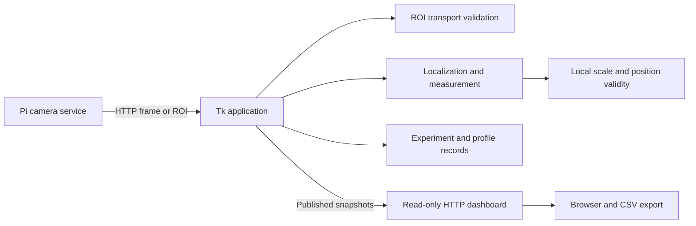

# Modular framework

Branch: `refactor/modular-framework`. Baseline: [`d7a953d`](https://github.com/CCZSZSL/filament-inspector/tree/d7a953decb0363b63acaccee0b1978af9b328a44).

## Decision

The old framework grew through versioned UI subclasses. Algorithms imported helpers and measurement methods from Tk classes, and two HTTP servers differed mostly in version labels and asset paths.

Two approaches were considered:

1. Flatten all UI subclasses and replace their state with a new controller. This could shorten the inheritance chain, but changes method resolution, callbacks, calibration guards and GUI lifecycle together.
2. Extract the existing measurement engine, group modules by responsibility, centralize paths and consolidate the duplicate HTTP service while preserving UI method resolution.

This branch implements option 2. It simplifies module boundaries without redesigning the estimator or silently removing inherited behavior. It is not a claim that the entire legacy UI has been rewritten.

## Data flow

The diagram describes data flow. The algorithm and calibration packages do not import the UI or camera stack. The web server does not call the camera or perform measurements.

## Entry points and responsibilities

| Area | Location | Responsibility |
|---|---|---|
| Host | `python -m filament_inspector` | Start the Tk app; `--help` and `--version` do not start Tk. |
| Pi | `python -m filament_inspector.camera` | Full-frame and optional native-pixel ROI HTTP acquisition. |
| Algorithm | `algorithms/` | Background location, edge crossings, original paper-method engine, seed model and fusion. |
| Calibration | `calibration/` | Reference scales, coordinate validation and position compensation. |
| Transport | `acquisition/` | Validate ROI geometry/epochs and install pixels without rescaling. |
| Records | `recording/` | Experiment logging and approximate axial profiles. |
| UI | `ui/` | Settings, camera controls and acquisition/measurement scheduling. |
| Web | `web/server.py`, `web/static/` | A single current dashboard implementation. |
| Paths | `paths.py` | Shared data root, independent of internal module locations. |

Paths in this table are relative to `filament_inspector/` unless specified otherwise. Package initializers do not eagerly load Tk, Picamera2 or libcamera.

## Measurement extraction

Eight helper functions, the original `_roi_bounds` and `_run_paper_method` methods, and the background locator were extracted without changing their ASTs. `PaperMethodEngine` has no Tk dependency. The GUI inherits it; the headless view adapter supplies plain get/set values and no-op display hooks. This preserves the existing settings/state contract rather than introducing a second estimator.

The old numerical arrays, validity decisions, calibration JSON schemas and capture/log names are retained. The shared web service now consistently serves the current dashboard, including when exercised through an intermediate UI class; the old v14.7.0 dashboard implementation/assets have been removed from this branch.

## Compatibility and migration

- `filament_diameter_ui_v1472.py` and `pi_live_camera_server_v1471.py` remain as compatibility launchers, not standalone implementations.
- `START_v1472_Mac.command` launches the package entry point.
- Internal versioned module imports are not retained as dozens of forwarding wrappers. Development code should import the functional package modules shown above.
- Install/copy the complete package on the Pi; copying only the old server filename no longer works.
- Default writable data locations remain at the repository root. `FILAMENT_INSPECTOR_DATA_DIR` selects a different root before process startup. No existing data is moved automatically.
- Configuration schemas, physical units, measurement thresholds and estimator defaults have not been intentionally changed.

## Validation and remaining risks

The existing regression suite runs after import/path updates. Additional tests exercise headless import boundaries, explicit data-root selection, CLI help and the host compatibility launcher. `tools/compare_baseline.py` compares 43 deterministic scenes with the original baseline in separate processes, including calibrated/uncalibrated views, movement, slope, bright/dark edge measurement and blank-frame rejection.

The UI still uses a deep sequence of inherited screens and legacy state. GUI callback cleanup warnings observed before this refactor are not addressed here. A future controller/composition rewrite should be validated separately, especially for cancellation, late camera responses and calibration invalidation. No live Pi/Mac rig, physical accuracy or real throughput validation has been performed for this branch.

See [the validation record](../VALIDATION.md) for actual test outcomes.
